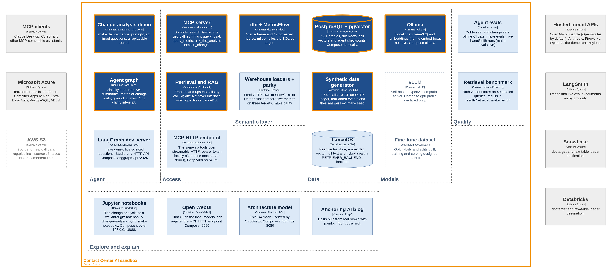
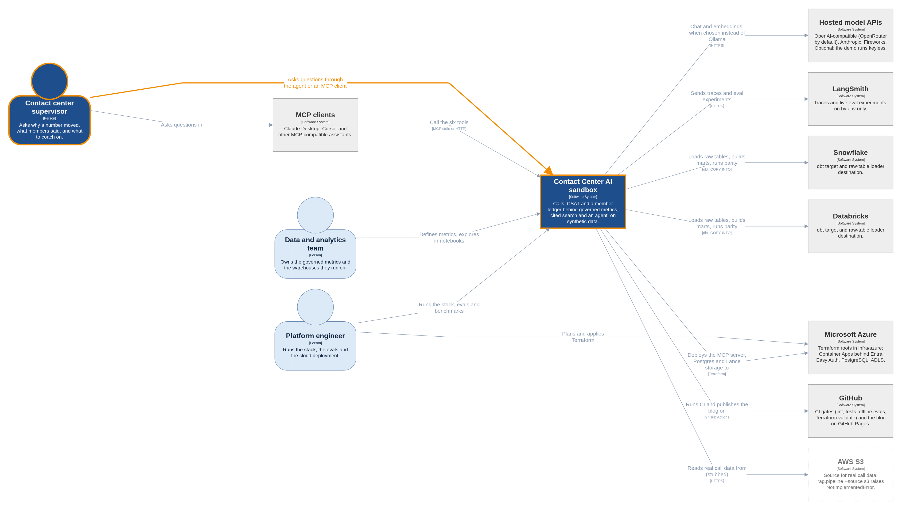
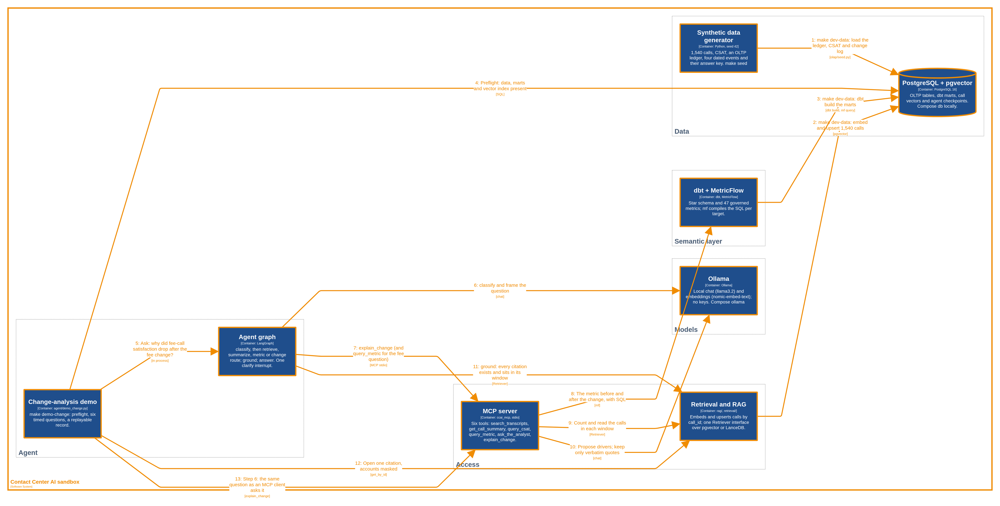
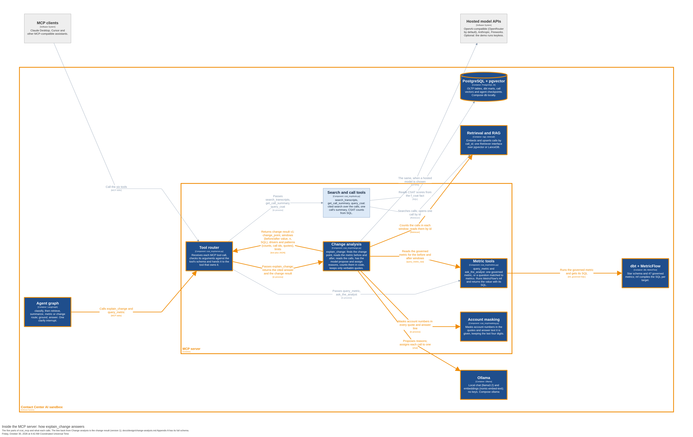
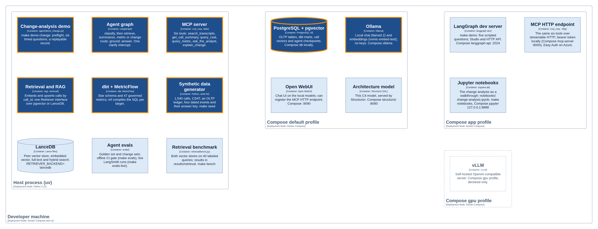
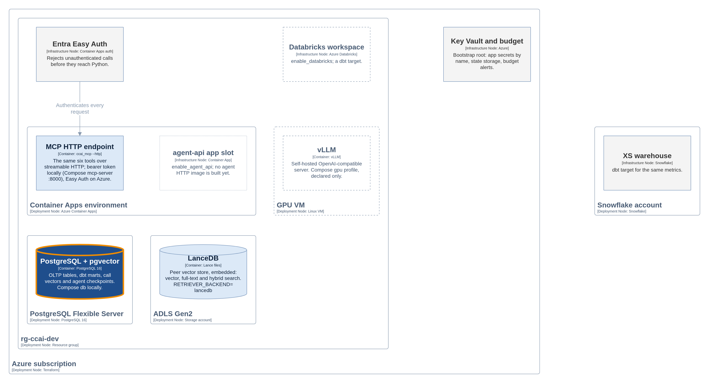

# Map: what this repo carries

This repo is a working sandbox for what AI can do in a credit union contact center. It is one
part of a larger effort to show credit unions a range of possibilities, on synthetic data only.
One path through it is a finished demo: `make demo-change` asks why a metric moved after a
change and answers with the governed metric, the SQL and cited calls. Everything else here is
built to be tried, compared or extended, and some of it is partial or only stubbed.

This page is the map. [TOUR.md](TOUR.md) is the walk-through, with commands and real output.
The diagrams come from one Structurizr model, `docs/architecture/workspace.dsl`; the
[architecture README](architecture/README.md) covers editing and exporting them. Each view is
exported as SVG (for redrawing) and PNG (3840 px wide, for slides).

**Legend.** Dark boxes with an orange border are exercised by `make demo-change`, and orange
lines are its calls. Light boxes are built and documented. Dashed boxes are partial; dotted boxes
are planned or stubbed. Grey boxes are systems outside the repo.

## Everything the repo runs

## Who uses it and what it talks to

## The demo path, step by step

Steps 1 to 3 are `make dev-data`, run once. `make demo-change-replay` prints the last verified
run with no model, database or network.

## Inside the MCP server

The five parts of `ccai_mcp` and what each calls, with the change result (v1) that `explain_change` returns. Appendix A of [design/change-analysis.md](design/change-analysis.md#appendix-a-interfaces) has the full result schema.

## Where it runs

## Capabilities

Status: **demo path** (exercised by `make demo-change`), **built** (built and documented, off the
demo path), **partial** (some built, the rest designed or declared), **stub** (the code path
raises `NotImplementedError`).

| Capability | What it is | Status | Entry point |
|---|---|---|---|
| Why a number moved | `explain_change`: a governed metric before and after a logged change, the drivers counted in code, cited calls, a coaching follow-up | demo path | `make demo-change`; `make demo-change-replay`; MCP tool `explain_change` |
| Governed metrics | dbt star schema and 47 MetricFlow metrics; the agent asks which metric an ambiguous term means instead of guessing | demo path | MCP tools `query_metric`, `ask_the_analyst`; `olap/dbt/` |
| Synthetic credit union data | Seed-42 calls, CSAT, a member ledger and four dated events with their answer key | demo path | `make seed`; `make dev-data` |
| Supervisor agent and MCP access | LangGraph graph with four routes and one clarify interrupt; seven MCP tools over stdio (demo path) or streamable HTTP; LangGraph dev server; Open WebUI | demo path (agent, stdio); built (HTTP, dev server, UI) | `make demo`; `python -m ccai_mcp.server [--http]`; Compose `langgraph-api`, `mcp-server`, `open-webui` |
| Cited call search | Embedding, idempotent ingest and a Retriever interface over pgvector or LanceDB as peers; the demo counts and cites calls through it, and `search_transcripts` and `get_call_summary` answer from it | demo path (Retriever); built (RAG answers, LanceDB) | `make ingest`; `python -m rag.pipeline --query "..."`; `RETRIEVER_BACKEND` |
| Explore and explain | The change analysis as a notebook; the Anchoring AI blog series; these diagrams | built (notebook, diagrams); partial (blog: four posts published) | `make notebooks`; `bash blogs/build.sh`; `docker compose up structurizr` |
| Quality and evaluation | Golden and change eval sets scored offline as a CI gate and live in LangSmith; a retrieval benchmark across both stores | built; runs recorded in `results/` | `make evals`; `make evals-live`; `make bench` |
| Warehouse portability | The same metrics on Postgres, Snowflake and Databricks: loaders, dbt targets, a parity check, an Apache Ossie export | built; parity run on all three targets | `make parity`; `make load-snowflake`; `make dbt-build WAREHOUSE=snowflake` |
| Cloud deployment | Terraform for Azure (Container Apps behind Entra Easy Auth, PostgreSQL, ADLS, optional GPU VM and Databricks) and a Snowflake root | validated in CI; not deployed | `infra/azure/` |
| Model choice and fine-tuning | Five chat providers behind one switch; the fine-tune dataset; a vLLM service | partial: providers built, fine-tune dataset only, vLLM declared | `LLM_PROVIDER`; `make finetune-data`; Compose `gpu` profile |
| Real call data in | Reading recordings and transcripts from S3; CSAT in the vector store | stub | `python -m rag.pipeline --source s3` |
